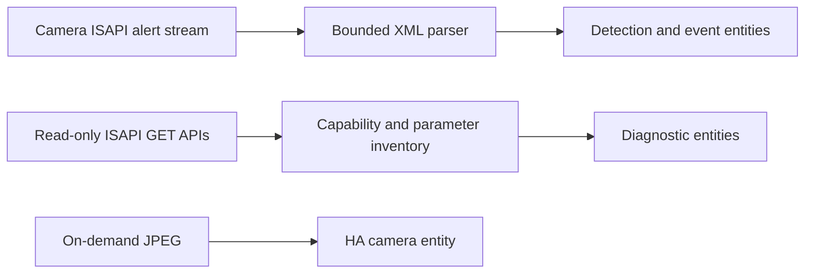

# ISAPI Vision

**Public beta · v0.1.0b1 · MIT licensed · Local push · Read-only**

[Releases](https://github.com/RealBlueSky227/ha-isapi-vision/releases) · [Report a bug or camera compatibility](https://github.com/RealBlueSky227/ha-isapi-vision/issues/new/choose) · [Security](SECURITY.md)

ISAPI Vision connects compatible local cameras directly to Home Assistant through Hikvision-style ISAPI. It provides immediate event-driven detection updates, capability discovery, optional settings sensors and authenticated snapshots. No cloud account, MQTT broker, external listener or separate AI inference service is required.

This is an independent community integration. It is not endorsed by ANNKE, Hikvision or Home Assistant. Beta feedback is welcome; compatible firmware can expose different events and API paths.

## Features

- Person, vehicle and general motion binary sensors, when the camera actually exposes those features; dashboard icons are included.
- Capability-based discovery for line crossing, intrusion, region events, tampering, storage faults and alarm inputs. Missing APIs stay unknown, rather than being guessed unsupported from firmware/model names.
- A native HA event entity that preserves accepted unmapped alarm types for automations.
- Configurable off debounce after a trigger ends, plus a separate missing end-event timeout.
- Device/event-stream connectivity, reconnect backoff, unavailable states and unload cleanup.
- On-demand JPEG snapshots, parameter inventory, and optional diagnostic parameter sensors (disabled by default).
- Multiple camera entries, per-channel monitoring, reauthentication, reconfiguration and sanitized diagnostics.
- HTTP Digest authentication and optional HTTPS with certificate validation enabled by default.

## Architecture

Detections come from a persistent push connection to `/ISAPI/Event/notification/alertStream`. They update entities when a matching notification arrives; they do not wait for a settings poll. The separate parameter/capability poll defaults to 120 seconds. No latency benchmark or continuous occupancy guarantee is claimed.

## Camera compatibility

| Hardware | Evidence / status |
| --- | --- |
| ANNKE FCD600, reporting **I51HD**, firmware **V5.8.10** | Primary development camera. Device/settings reads, capability discovery, stream keepalives and JPEG snapshots were verified. HTTPS device-information access was also confirmed in a deployed HA container with certificate verification disabled for the camera's mismatched certificate. |
| Other ANNKE and Hikvision-style ISAPI cameras / NVRs | **Experimental.** Capability discovery adapts to actual replies; physical compatibility is not yet established. |

Deliberate physical person/vehicle activation, end timing and disconnect recovery remain acceptance checks; representative XML, state transitions, reconnection and HA lifecycle behavior are tested automatically. FCD600 product generations differ. A camera exposing ISAPI does not necessarily expose classified detections or smart events. See [validation evidence and limits](VALIDATION.md).

## Install with HACS as a custom repository

Requires **Home Assistant 2025.7 or newer**; the release test suite targets current stable **2026.10.2**. Local integration logos require HA 2026.3 or newer. Install and configure HACS first using its [official instructions](https://www.hacs.xyz/docs/use/).

1. Open **HACS → ⋮ → Custom repositories**.
2. Add `https://github.com/RealBlueSky227/ha-isapi-vision`, category **Integration**.
3. Open **ISAPI Vision** in HACS and select **Download**. Enable **Show beta versions** in the download/version dialog and select **v0.1.0b1**. For an existing HACS download, use **⋮ → Redownload**, enable beta versions and select that tag. Labels can differ by HACS version.
4. Restart Home Assistant.
5. Open **Settings → Devices & services → Add integration → ISAPI Vision**.

Only a prerelease is published for this beta. If the version list is empty, enable beta versions and refresh HACS; do not treat the absence of a stable release as a camera connection error. The default branch is hidden from the HACS version selector so a tagged release can be selected deliberately.

This custom-repository installation is **not acceptance into the official HACS catalog**. A catalog submission is prepared separately and requires maintainer review. [Official custom-repository instructions](https://www.hacs.xyz/docs/faq/custom_repositories/).

For manual installation, download `isapi_vision.zip` from the [beta release](https://github.com/RealBlueSky227/ha-isapi-vision/releases/tag/v0.1.0b1), create `/config/custom_components/isapi_vision`, and extract the ZIP contents into that directory. Its `manifest.json` must be directly inside that directory, then restart HA. HACS uses the tagged source directory; it does not require the manual-install ZIP.

## Existing installations

The domain remains **`isapi_vision`**, config-entry version remains 1, and serial/channel-derived unique IDs and device identifier namespaces are unchanged. Existing ISAPI Vision installations can replace the component through HACS without deleting/re-adding the integration. Back up HA first. Select this beta explicitly when moving from an unpublished development build numbered 0.4.0: the public version series starts at 0.1.0b1, so automatic version comparison may consider it older.

An older `annke_isapi` installation needs the [one-time stopped-HA domain migration](DEPLOYMENT.md) before switching folders. HACS does not run that standalone migration tool automatically. It is unnecessary for installations already using `isapi_vision`.

## Configure

| Setting | Meaning |
| --- | --- |
| Host | Local IP or DNS hostname only, such as `192.0.2.10`; omit scheme, port and path. |
| Username / password | A camera account permitted to read ISAPI settings, events and snapshots. Password input is hidden. |
| Port / Use HTTPS | Set both explicitly: usually HTTP/80 or HTTPS/443, according to camera settings. There is no silent HTTP fallback. |
| Verify HTTPS certificate | Enabled by default. Requires a trusted certificate matching the supplied hostname/IP. See troubleshooting for self-signed or mismatched certificates. |
| Camera channel | Video input number; normally **1** for a standalone camera. It selects the input to monitor, not the main/substream or a camera setting to change. Additional channels use separate entries. |

Enable the desired detection rules, arming schedules and **Notify Surveillance Center** linkage in the camera's own UI. The integration never enables or modifies camera rules.

Use the entry's **Configure** options to set **Sensor off debounce (seconds)** (default 0) and **Missing end-event timeout** (default 10). Active detections update immediately. Debounce delays the LOW transition until the selected time after the trigger ends; a new active trigger cancels the pending LOW. Set the missing-end timeout to 0 to require explicit inactive notifications. Independent alarm sources are aggregated. Faults do not use the missing-end watchdog; connection loss makes detections unavailable immediately. The event entity is not debounced.

Use **Reconfigure** for an address, port, HTTPS or credential change. Leaving its password blank preserves the saved value; enter a replacement explicitly to change it. Camera serial/channel identity must match. Saved passwords are never prefilled into forms. Protect HA configuration storage and backups; see [credential handling](SECURITY.md).

## Entities, defaults and dashboards

Discovered motion/person/vehicle and smart-event detectors are enabled by default. Tamper, video-loss, storage-fault and alarm-input detectors are optional diagnostics, created disabled by default when discovered. Individual parameter sensors are also disabled by default to avoid hundreds of redundant dashboard entities. Enable only useful diagnostics on the device page. Unsupported/unknown detector entities are not created preemptively; HA can retain historical unavailable entities from older builds until removed manually.

[Entity and discovery reference](docs/FEATURES.md) · [Built-in dashboard tiles](examples/dashboard.yaml) · [Automation examples](docs/AUTOMATIONS.md)

## Troubleshooting

| Symptom | Check |
| --- | --- |
| Certificate verification failed | The certificate must be trusted **and** match the configured hostname/IP. If camera identity has been verified separately, disabling **Verify HTTPS certificate** allows encrypted transport without identity validation. A properly issued matching certificate is needed to re-enable validation. |
| Cannot read device information | Check host, port, HTTPS selection, account permissions and access from the HA container/network, not only another computer. |
| Authentication failed / HTTP 401 | Verify the current camera credentials and account status. Browser login can use a different authentication path. Avoid repeated failed attempts that could trigger camera lockout. |
| Stream connected, no person/vehicle sensor | Download diagnostics and inspect feature support/enabled/evidence. Enable classification/rules/arming and surveillance-center linkage on the camera. Generic motion is not classified into people or vehicles by this integration. |
| Detector shows unavailable | Check event-stream connectivity, camera permissions and capability evidence. OFF must not be inferred from a disconnected stream. |
| Rule not discovered | Report model, firmware and sanitized endpoint/feature results. Missing paths can mean permissions or firmware differences; do not send credentials or raw XML. |
| Blank snapshot | Try again after camera load subsides. The substream is preferred with main-stream fallback; live RTSP video is separate. |
| HACS cannot find beta | Add the custom repository as Integration and enable beta versions in Download/Redownload. Restart HA after installation. |

Download diagnostics from the integration entry menu and inspect them before sharing. The [read-only probe](docs/DEVELOPMENT.md) prompts for a password and can test events independently of HA. Report problems through [issue templates](https://github.com/RealBlueSky227/ha-isapi-vision/issues/new/choose).

## Known limitations

- **Read-only:** no PTZ, siren, light, alarm-output writes, camera configuration changes or firmware updates are implemented. Existing camera controls from other integrations are independent.
- Snapshots only; no RTSP live video or audio. Keep an ONVIF/Generic Camera/Frigate entity for those.
- Recent camera events are not continuous presence or object counts. Detection accuracy comes from the camera.
- Known ISAPI endpoints only; not every proprietary parameter, NVR channel or model is supported. Firmware-specific scales/units are not guessed.
- No cloud, automatic network discovery or promised universal Hikvision compatibility.
- The Bronze checklist is a self-audit, **not an officially awarded HA Core quality tier**.

## Removal and feedback

Remove the ISAPI Vision entry in **Settings → Devices & services**, uninstall its download from HACS (or remove the manually installed component folder), and restart HA. Camera configuration and recordings are not modified. Keep or remove deployment backups separately.

Testers with other ANNKE/Hikvision-style ISAPI cameras are invited to submit [compatibility reports](https://github.com/RealBlueSky227/ha-isapi-vision/issues/new?template=camera_compatibility.yml), including limitations and failed features. [Contributing](CONTRIBUTING.md) · [Changelog](CHANGELOG.md) · [Validation](VALIDATION.md) · [Branding](BRANDING.md)
